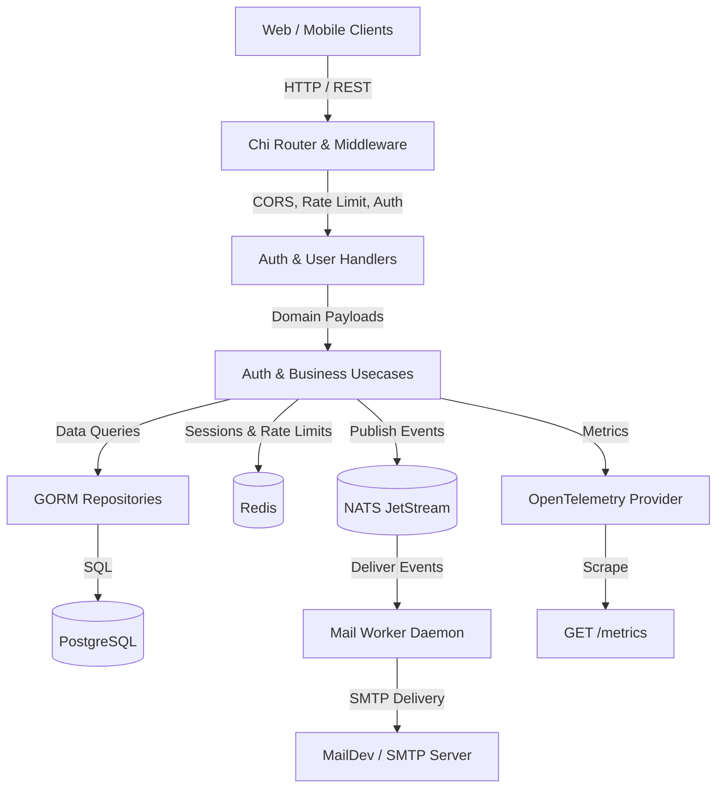

# Go Chi Boilerplate — Production-Grade REST API

A production-grade, secure, event-driven REST API boilerplate built in **Go 1.26** with **Chi router**, **PostgreSQL**, **Redis**, **NATS JetStream**, and **OpenTelemetry**.

---

## Key Features

- **Robust Authentication & Session Management**:
    - Dual-token JWT (short-lived access tokens, long-lived refresh tokens).
    - Refresh token rotation with atomic Redis Lua scripts and automatic token-reuse detection.
    - Multi-device active session listing with transport metadata (`IPAddress`, `UserAgent`).
    - Remote session revocation and global `logout-all` with instantaneous invalidation markers.
    - Rate-limited and lockout-escalated login throttler (anti-brute-force).
    - Anti-enumeration timing defense (dummy bcrypt password comparisons on nonexistent accounts).
- **Role-Based Access Control (RBAC)**:
    - Granular permissions and roles stored in PostgreSQL and embedded in JWT claims.
    - Fast, zero-DB middleware authorization (`RequireRole`, `RequirePermission`).
- **Account Status Lifecycle**:
    - Strict gating: `PENDING`, `ACTIVE`, `INACTIVE`, `SUSPENDED`, `BLOCKED`.
    - Transactional email verification and email change confirmation workflows.
- **Object Storage & Asset Management**:
    - S3-compatible file uploads (AWS S3, RustFS, MinIO, Cloudflare R2).
    - Secure presigned upload & preview URLs with custom expiration.
    - User avatar update & file management API.
- **Audit & Activity Logging**:
    - Generic activity log repository usable across all domain modules.
    - Automated event logging with IP address, User-Agent, and structured metadata.
- **Asynchronous Messaging & Background Workers**:
    - Event publishing over **NATS JetStream** (`APP_EVENTS` stream).
    - Decoupled **Mail Worker** with durable subscription, retry policies, and poison message termination.
    - Local email inspection via **MailDev** (SMTP on port 1025, Web UI on port 1080).
- **Observability & Telemetry**:
    - Native **OpenTelemetry (OTEL)** metrics and distributed tracing.
    - Prometheus exposition format at `GET /metrics`.
    - Distributed tracing with `X-Trace-ID` and structured `slog` correlation.
    - Liveness and Readiness probes at `GET /health/live` and `GET /health/ready` (parallel ping to PostgreSQL, Redis, and NATS).
    - Zero-PII safe categorical labels.
- **Interactive OpenAPI / Swagger Documentation**:
    - Auto-generated Swagger spec served at `GET /swagger/index.html`.
    - Regenerate anytime with `make swagger-gen`.
- **Multi-Stage Containerization & CI/CD**:
    - Multi-target `Dockerfile` (`http` API server and `worker` daemon).
    - GitHub Actions CI workflow (linting, vulnerability scan, testing, Docker build).
- **Clean Architecture & Dependency Injection**:
    - Explicit layers: `Handler` -> `Usecase` -> `Repository` -> `Entities`.
    - Compile-time dependency injection using **Google Wire**.
    - Database schema migrations using **Goose**.

---

## Architecture Overview



---

## Quick Start

### 1. Prerequisites

- [Go 1.26+](https://go.dev/dl/)
- [Docker & Docker Compose](https://www.docker.com/)
- [Goose](https://github.com/pressly/goose) (`go install github.com/pressly/goose/v3/cmd/goose@latest`)
- [Wire](https://github.com/google/wire) (`go install github.com/google/wire/cmd/wire@latest`)

### 2. Clone & Setup Environment

```bash
git clone https://github.com/nassabiq/go-chi-boilerplate.git
cd go-chi-boilerplate
cp .env.example .env
```

### 3. Start Local Infrastructure

Start PostgreSQL, Redis, NATS JetStream, and MailDev:

```bash
docker compose up -d
```

Check running services:

- **PostgreSQL**: `localhost:5432`
- **Redis**: `localhost:6379`
- **NATS JetStream**: `localhost:4222` (Monitoring: `http://localhost:8222`)
- **RustFS (S3 Storage)**: `localhost:9000` (Console: `http://localhost:9001`)
- **MailDev Web UI**: `http://localhost:1080` (SMTP: `localhost:1025`)

### 4. Run Database Migrations

Runs schema migrations and seeds initial static data (roles, permissions, and default superadmin: `admin@example.com` / `Password123!`):

```bash
make migrate-up
```

### 5. Generate Wire Dependencies (Optional if already generated)

```bash
make wire
```

### 6. Run the Services

To run both the HTTP API server and the background Mail Worker concurrently in a single terminal:

```bash
make run
```

_(Pressing `Ctrl+C` will gracefully shut down both services simultaneously)._

Alternatively, you can run them in separate terminals:

- HTTP API Server: `make run-http` (or `go run ./cmd/http`)
- Mail Worker: `make run-worker` (or `go run ./cmd/worker/mail`)

---

## Testing

### Unit Tests

Run all unit tests across handlers, usecases, repositories, and packages:

```bash
go test -count=1 ./...
```

### Integration & End-to-End Tests

Run the complete integration and E2E test suite against real Docker services:

```bash
make test-integration
# or
go test -tags=integration -count=1 -v ./tests/integration/...
```

To run only the end-to-end user lifecycle flows:

```bash
go test -tags=integration -count=1 -v ./tests/integration/... -run 'TestE2E_'
```

### Code Quality & Linting

Run `golangci-lint` with the strict enterprise configuration:

```bash
make lint
# or auto-fix issues
make lint-fix
```

---

## Documentation, Swagger & Postman

- **Interactive Swagger UI**: Visit `http://localhost:8080/swagger/index.html` while the server is running (Regenerate anytime via `make swagger-gen`).
- **Health & Readiness Probes**:
    - Liveness: `GET http://localhost:8080/health/live`
    - Readiness (PostgreSQL, Redis, NATS): `GET http://localhost:8080/health/ready`
- **[Postman Collection & Guide](docs/postman.md)**: Ready-to-import Postman collection with automatic token extraction and step-by-step test execution ([Collection File](docs/postman_collection.json), [Environment File](docs/postman_environment.json)).
- **[Authentication Guide](docs/auth.md)**: Endpoint reference, token rotation, session lifecycle, and RBAC specifications.
- **[Messaging Guide](docs/messaging.md)**: NATS JetStream stream definitions, event schemas, Mail Worker daemon, and MailDev setup.
- **[Roadmap Plan](docs/plan.md)**: Engineering phase-by-phase implementation plan.

---

## Project Structure

```
.
├── .github/
│   └── workflows/ci.yml        # Automated GitHub Actions CI pipeline
├── .golangci.yml               # Linter configuration rules
├── Dockerfile                  # Multi-stage production container
├── Makefile                    # Automation targets
├── cmd/
│   ├── http/                   # HTTP API entrypoint & Wire injector
│   └── worker/
│       └── mail/               # Mail worker daemon entrypoint & Wire injector
├── docs/                       # Architectural guides & documentation
│   ├── auth.md                 # Full authentication, session & token documentation
│   ├── messaging.md            # NATS JetStream & Mail worker documentation
│   ├── plan.md                 # Engineering roadmap & specifications
│   ├── postman.md              # Postman setup and execution guide
│   ├── postman_collection.json # Step-by-step Postman collection
│   ├── postman_environment.json# Postman environment variables
│   └── swagger/                # Auto-generated OpenAPI / Swagger specs
├── internal/
│   ├── config/                 # Environment & configuration loaders
│   ├── core/
│   │   ├── domain/             # Entities, DTOs, request payloads
│   │   ├── handler/            # HTTP handlers (auth, user, storage, health)
│   │   ├── repositories/       # Database repositories (GORM - auth, user, activity)
│   │   └── usecase/            # Business usecases (auth, user, storage)
│   ├── dependency/             # Wire dependency provider set
│   ├── messaging/              # Event schemas and NATS publisher
│   ├── middleware/             # Chi middlewares (auth, CORS, rate-limit, RBAC, tracing)
│   ├── pkg/
│   │   ├── auth/               # JWT, SessionManager, Password, LoginThrottler
│   │   ├── cache/              # Redis client factory
│   │   ├── database/           # PostgreSQL & TxManager
│   │   ├── health/             # Health & readiness component checker
│   │   ├── mail/               # SMTP client & sender
│   │   ├── nats/               # NATS JetStream client factory
│   │   ├── ratelimit/          # Redis sliding-window rate limiter
│   │   └── telemetry/          # OpenTelemetry metrics, tracer & Prometheus handler
│   ├── router/                 # Chi route definitions
│   ├── utils/                  # Enums, errors, response wrappers, helpers
│   └── worker/
│       └── mail/               # Mail worker consumer & email templates
├── migrations/                 # Goose SQL schema migrations & seed data
├── tests/
│   └── integration/            # HTTP integration and E2E test suite
├── docker-compose.yml          # Local container infrastructure
└── README.md
```
