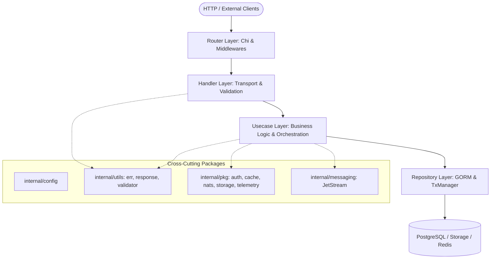

# Architecture & Layering Guide

This document details the architectural foundation, layer responsibilities, dependency flow, and Google Wire dependency injection patterns in this repository.

---

## 1. Clean Architecture Overview

The system strictly adheres to Clean Architecture with unidirectional control and dependency flow:



### Strict Layer Boundaries

| Layer | Location | Allowed to Call | Forbidden to Call / Use |
|---|---|---|---|
| **Router** | `internal/router/` | `internal/core/handler`, `internal/middleware` | Database, repositories, directly mutating payloads |
| **Handler** | `internal/core/handler/` | `internal/core/usecase`, `internal/utils/*` | `*gorm.DB`, repositories, direct database queries |
| **Usecase** | `internal/core/usecase/` | `internal/core/repositories`, `internal/pkg/*`, `internal/messaging/*` | `http.ResponseWriter`, `*http.Request`, HTTP headers |
| **Repository** | `internal/core/repositories/` | `internal/pkg/database (TxManager)`, `gorm.DB` | HTTP transport, payload validation, business rules |
| **Domain** | `internal/core/domain/` | Pure Go structs & stdlib | Any external dependency |

---

## 2. Directory Responsibilities

### `cmd/`
- `cmd/http/`: Main HTTP application entrypoint. Boots configuration, Wire container, initializes telemetry, database migrations check, and starts the HTTP server with graceful shutdown.
- `cmd/worker/mail/`: Background worker process. Consumes JetStream mail topics and sends emails via SMTP.

### `internal/core/domain/`
- `entities/`: GORM models representing database tables. Include columns, tags, and GORM hooks.
- `payloads/`: Incoming request payload structs with `validate:"..."` tags. Never expose database-specific fields.
- `dto/`: Outgoing response data transfer objects. Prevent leaking sensitive entity fields (e.g., password hashes, internal metadata).

### `internal/core/handler/`
- Implements HTTP handlers.
- Decodes request bodies using `request.DecodeJSON[T](r)` or query parameters using `request.List(r)`.
- Validates path parameters with `request.PathInt64(r, "id")`.
- Invokes Usecase methods.
- Formats outputs with `response.Success` or `response.ErrorResponse`.
- Contains Swaggo doc comments for OpenAPI spec generation.

### `internal/core/usecase/`
- Encapsulates business logic, domain validation, and policy checks.
- Orchestrates multi-repository operations inside `TxManager.WithTx`.
- Emits domain events via `messaging.EventPublisher`.
- Records OpenTelemetry metric counters and spans.
- Maps internal entities to DTO responses (`compose<Entity>`).

### `internal/core/repositories/`
- Implements data persistence using GORM.
- Always accesses the database via `repo.DB(ctx)` to support transparent transactions.
- Handles pagination, filtering, and sorting using helper query builders.
- Enforces optimistic concurrency checks on mutations.

---

## 3. Dependency Injection with Google Wire

All dependencies are wired at compile time using Google Wire (`github.com/google/wire`).

### Wire Provider Sets (`internal/dependency/provider.go`)
```go
var ProviderSet = wire.NewSet(
    config.Load,
    database.NewDB,
    database.NewTxManager,
    auth.NewJWT,
    cache.NewRedis,
    // ...
    wire.Struct(new(repositories.Dependencies), "*"),
    repositories.New,

    wire.Struct(new(usecase.Dependencies), "*"),
    usecase.New,

    wire.Struct(new(handler.Dependencies), "*"),
    handler.New,

    wire.Struct(new(router.Dependencies), "*"),
    router.New,

    wire.Struct(new(App), "*"),
)
```

### Adding a New Dependency to the Injection Graph:
1. If adding a new third-party adapter or service:
   - Add the constructor function to `internal/dependency/provider.go` inside `ProviderSet`.
2. If adding fields to `Dependencies` structs in `repositories`, `usecase`, `handler`, or `router`:
   - Declare the exported field in the corresponding `Dependencies` struct.
3. Run code generation:
   ```bash
   make wire
   ```
4. Verify `cmd/http/wire_gen.go` compiles cleanly:
   ```bash
   go build ./cmd/http/...
   ```
