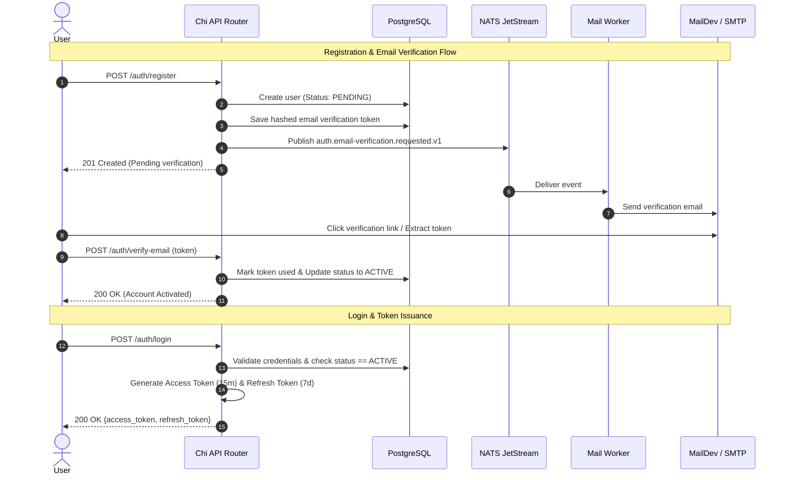
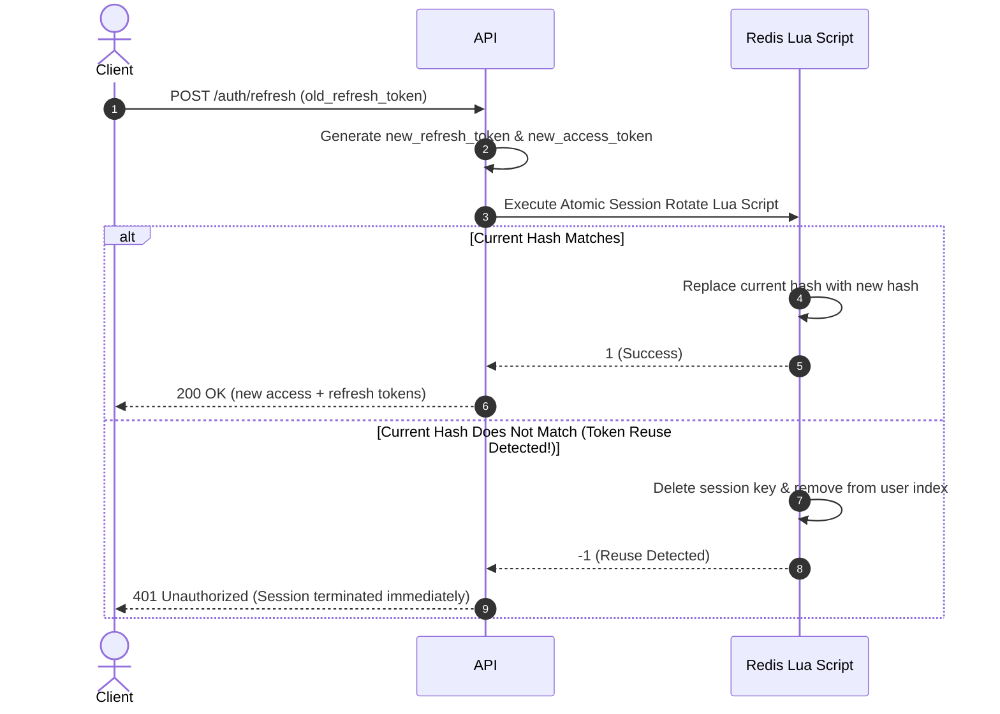
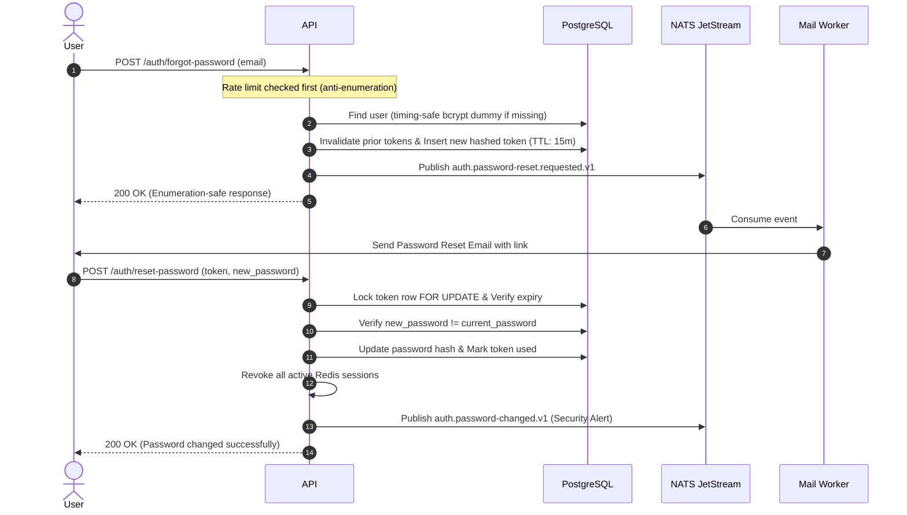

# Authentication & Authorization System Documentation

This document provides a comprehensive technical overview of the authentication, authorization, session management, and account lifecycle architecture in the boilerplate.

---

## 1. Auth Endpoints Reference

All authentication endpoints are grouped under `/auth`:

| Method   | Path                        | Auth Required | Description                                          | Request Payload / Params                             | Success Status              | Error Codes                                                                                                                                                                  |
| -------- | --------------------------- | ------------- | ---------------------------------------------------- | ---------------------------------------------------- | --------------------------- | ---------------------------------------------------------------------------------------------------------------------------------------------------------------------------- |
| `POST`   | `/auth/register`            | Basic Auth\*  | Register new account (`PENDING`)                     | `{"name": "...", "email": "...", "password": "..."}` | `201 Created`               | `E_VALIDATION`, `E_USER_ALREADY_EXISTS`, `E_AUTH_2`                                                                                                                          |
| `POST`   | `/auth/login`               | Basic Auth\*  | Authenticate user & issue tokens                     | `{"email": "...", "password": "..."}`                | `200 OK`                    | `E_AUTH_1` (invalid creds), `E_AUTH_7` (throttled), `E_AUTH_9` (inactive), `E_AUTH_10` (pending), `E_AUTH_11` (suspended), `E_AUTH_12` (blocked)                             |
| `GET`    | `/auth/me`                  | Bearer Token  | Get current authenticated user profile               | None                                                 | `200 OK`                    | `E_AUTH_5` (invalid/expired/revoked token)                                                                                                                                   |
| `POST`   | `/auth/refresh`             | Basic Auth\*  | Rotate refresh token for new access & refresh tokens | `{"refresh_token": "..."}`                           | `200 OK`                    | `E_AUTH_8` (invalid refresh token / reuse detected)                                                                                                                          |
| `POST`   | `/auth/logout`              | Bearer Token  | Revoke current session                               | None                                                 | `204 No Content`            | `E_AUTH_5`                                                                                                                                                                   |
| `POST`   | `/auth/logout-all`          | Bearer Token  | Invalidate all sessions of user                      | None                                                 | `204 No Content`            | `E_AUTH_5`                                                                                                                                                                   |
| `GET`    | `/auth/sessions`            | Bearer Token  | List all active sessions with metadata               | None                                                 | `200 OK`                    | `E_AUTH_5`                                                                                                                                                                   |
| `DELETE` | `/auth/sessions/{id}`       | Bearer Token  | Revoke specific active session by ID                 | URL path param: `id`                                 | `204 No Content`            | `E_AUTH_5`                                                                                                                                                                   |
| `POST`   | `/auth/verify-email`        | Basic Auth\*  | Verify email & activate pending user                 | `{"token": "..."}`                                   | `200 OK`                    | `E_AUTH_16` (invalid or expired verification token)                                                                                                                          |
| `POST`   | `/auth/resend-verification` | Basic Auth\*  | Resend verification email                            | `{"email": "..."}`                                   | `200 OK` (Enumeration-safe) | `E_VALIDATION`, `E_AUTH_7` (throttled)                                                                                                                                       |
| `POST`   | `/auth/forgot-password`     | Basic Auth\*  | Request password reset email                         | `{"email": "..."}`                                   | `200 OK` (Enumeration-safe) | `E_VALIDATION`, `E_AUTH_7` (throttled)                                                                                                                                       |
| `POST`   | `/auth/reset-password`      | Basic Auth\*  | Reset password using valid reset token               | `{"token": "...", "new_password": "..."}`            | `200 OK`                    | `E_AUTH_13` (invalid token), `E_AUTH_15` (same password)                                                                                                                     |
| `POST`   | `/auth/change-password`     | Bearer Token  | Change password for logged-in user                   | `{"current_password": "...", "new_password": "..."}` | `200 OK`                    | `E_AUTH_14` (invalid current), `E_AUTH_15` (same password)                                                                                                                   |
| `POST`   | `/auth/change-email`        | Bearer Token  | Request email address change                         | `{"new_email": "...", "password": "..."}`            | `200 OK`                    | `E_AUTH_14` (wrong pass), `E_USER_ALREADY_EXISTS`                                                                                                                            |
| `POST`   | `/auth/verify-email-change` | Basic Auth\*  | Confirm email address change                         | `{"token": "..."}`                                   | `200 OK`                    | `E_AUTH_17` (invalid token)                                                                                                                                                  |

_\*Note: Basic Auth is enforced on all non-bearer endpoints if `BASIC_AUTH_USERNAME` and `BASIC_AUTH_PASSWORD` are configured. If left empty, the middleware bypasses without requiring credentials._

---

## 2. Basic Auth Protection for Non-Bearer Routes

To protect public endpoints against unauthenticated scrapers and automated bots, non-bearer endpoints (such as `/auth/login`, `/auth/register`, `/auth/refresh`, and `/metrics`) are guarded by `middleware.BasicAuth(cfg.Auth.BasicAuth)`.

### How it works:

- **Credentials**: Configured via `BASIC_AUTH_USERNAME` and `BASIC_AUTH_PASSWORD` in `.env`.
- **Timing-Safe**: Credentials are validated using `crypto/subtle.ConstantTimeCompare` to avoid timing side-channels.
- **Conditional Activation**:
    - If both `BASIC_AUTH_USERNAME` and `BASIC_AUTH_PASSWORD` are empty (default in local development), the middleware acts as a **transparent no-op**.
    - If configured, any non-bearer request without matching `Authorization: Basic <base64>` credentials is immediately rejected with `401 Unauthorized` and `WWW-Authenticate: Basic realm="Restricted"`.

---

## 3. Authentication & Verification Flow

---

## 4. Token Lifecycle & Rotation

### Dual-Token Pattern

1. **Access Token (JWT)**:
    - **TTL**: Short-lived (default 15 minutes, configurable via `JWT_ACCESS_EXPIRY`).
    - **Claims**: `sub` (User ID), `sid` (Session ID), `roles` (`[]string`), `permissions` (`[]string`), `iss`, `iat`, `exp`.
    - **Validation**: Verified cryptographically with HMAC-SHA256 (`JWT_ACCESS_SECRET`) and checked against Redis session existence and revocation marker on every protected request.

2. **Refresh Token (JWT)**:
    - **TTL**: Long-lived (default 7 days, configurable via `JWT_REFRESH_EXPIRY`).
    - **Claims**: `sub` (User ID), `sid` (Session ID), `iat`, `exp`.
    - **Storage**: Only the SHA-256 hash of the active refresh token (`auth:session:{sid}.refresh_hash`) is stored in Redis.

### Rotation & Automatic Reuse Detection

Every call to `POST /auth/refresh` follows strict token rotation:

---

## 5. Session Management Lifecycle

### Redis Key Schema

- `auth:session:{session_id}` (`Hash`):
    - `user_id`: string int64
    - `refresh_hash`: SHA-256 hex string of active refresh token
    - `ip_address`: client IP address
    - `user_agent`: client user agent
    - `created_at`: unix timestamp in milliseconds
    - `expires_at`: unix timestamp in milliseconds
    - TTL matches the refresh token expiry (7 days).
- `auth:user:sessions:{user_id}` (`Sorted Set`):
    - Index of active session IDs sorted by expiration timestamp score.
- `auth:user:revoked_before:{user_id}` (`String`):
    - Unix millisecond timestamp set upon `logout-all` or password reset. Any session created before this marker is automatically rejected.

### Session Invalidation Scenarios

1. **Single Session Logout** (`POST /auth/logout`): Deletes the calling session key and removes it from the user set.
2. **Device Revocation** (`DELETE /auth/sessions/{id}`): Revokes a specific remote session by ID.
3. **Logout All** (`POST /auth/logout-all`): Sets the `revoked_before` marker in Redis, instantly invalidating all outstanding access tokens and refresh tokens across all devices.
4. **Password Reset / Change**: Automatically triggers `RevokeAll`, forcing re-authentication on all devices.

---

## 6. Password Reset Flow

---

## 7. Account Status Rules & State Machine

Every user account belongs to one of five statuses:

| Status ID | Status Name | Login Allowed            | Status Description                                      |
| --------- | ----------- | ------------------------ | ------------------------------------------------------- |
| `1`       | `PENDING`   | **No** (403 `E_AUTH_10`) | Newly registered, awaiting email verification.          |
| `2`       | `ACTIVE`    | **Yes**                  | Fully verified and active account.                      |
| `3`       | `INACTIVE`  | **No** (403 `E_AUTH_9`)  | Deactivated by user or administrative policy.           |
| `4`       | `SUSPENDED` | **No** (403 `E_AUTH_11`) | Temporarily restricted due to policy/compliance review. |
| `5`       | `BLOCKED`   | **No** (403 `E_AUTH_12`) | Permanently banned/blocked from access.                 |

### Transitions:

- `PENDING` -> `ACTIVE`: Triggered exclusively upon valid email token verification.
- `ACTIVE` -> `INACTIVE`: User deactivation.
- `ACTIVE`/`PENDING` -> `SUSPENDED` / `BLOCKED`: Administrative moderation actions.

---

## 8. Role-Based Access Control (RBAC)

- Roles and permissions are stored in PostgreSQL (`roles`, `permissions`, `role_permissions`, `user_roles`).
- Upon login and token refresh, user role codes and permission codes are embedded inside the Access Token JWT claims.
- Route-level middleware enforces access without redundant database lookups:
    - `middleware.RequireRole("admin", "superadmin")`
    - `middleware.RequirePermission("users:delete", "reports:export")`

---

## 9. Observability & Telemetry

Prometheus metrics are exposed at `GET /metrics` (guarded with Basic Auth if configured) via OpenTelemetry SDK:

- `auth_login_success_total`
- `auth_login_failure_total{reason="..."}`
- `auth_login_throttled_total`
- `auth_registration_success_total`
- `auth_email_verification_success_total`
- `auth_password_reset_requested_total`
- `auth_password_reset_success_total`
- `auth_password_reset_failure_total{reason="..."}`
- `auth_session_created_total{type="login|refresh"}`
- `auth_session_revoked_total{reason="..."}`
- `mail_sent_total{topic="..."}`
- `mail_failed_total{topic="...", type="transient|poison"}`
- `mail_retry_total{topic="..."}`
