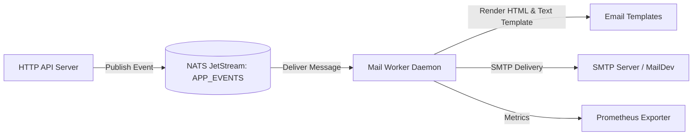

# Messaging & Mail Worker Architecture

This document describes the asynchronous event architecture using NATS JetStream and the background Mail Worker service.

---

## 1. NATS JetStream Architecture

The application uses **NATS JetStream** for durable, at-least-once asynchronous event delivery.

- **Stream Name**: `APP_EVENTS`
- **Subject Filter**: `auth.>`
- **Storage**: File-backed JetStream storage (`/data` in Docker container)
- **Retention Policy**: Limits-based (messages retained until consumed or TTL expires)

### Topic Naming Convention

Events follow the versioned topic convention: `{domain}.{event-name}.{version}`

| Subject / Topic                        | Event Struct                 | Trigger                                  | Payload Summary                                                              |
| -------------------------------------- | ---------------------------- | ---------------------------------------- | ---------------------------------------------------------------------------- |
| `auth.email-verification.requested.v1` | `EmailVerificationRequested` | User registration or resend verification | `user_id`, `email`, `name`, `verification_url`, `expires_at`                 |
| `auth.password-reset.requested.v1`     | `PasswordResetRequested`     | User forgot-password request             | `user_id`, `email`, `name`, `reset_url`, `expires_at`                        |
| `auth.password-changed.v1`             | `PasswordChanged`            | Password reset or change completed       | `user_id`, `email`, `name`, `reason` (`reset_password` \| `change_password`) |
| `auth.email-change.requested.v1`       | `EmailChangeRequested`       | User email update request                | `user_id`, `new_email`, `confirm_url`, `expires_at`                          |

---

## 2. Mail Worker Service

The Mail Worker (`cmd/worker/mail/main.go`) runs as an independent daemon decoupled from the HTTP API.



### Worker Consumer Configuration

- **Durable Name**: `mail-worker-v1`
- **Filter Subject**: `auth.>` (captures all authentication events)
- **Ack Policy**: `AckExplicitPolicy`
- **Ack Wait**: 30 seconds
- **Max Deliver**: 5 attempts
- **Retry Delay**: 10 seconds

### Failure Classification & Poison Handling

The worker classifies errors into two distinct categories:

1. **Poison Messages** (`poisonError`):
    - Causes: Corrupted JSON, missing mandatory fields, invalid envelope.
    - Action: `msg.Term()` terminates the message immediately to prevent endless retries from clogging the queue.
    - Metric: `mail_failed_total{type="poison"}`.

2. **Transient Failures**:
    - Causes: SMTP server temporarily unreachable, network timeout, connection reset.
    - Action: `msg.NakWithDelay(retryDelay)` reschedules redelivery after the configured delay.
    - Metric: `mail_retry_total` and `mail_failed_total{type="transient"}`.

3. **Successful Send**:
    - Action: `msg.Ack()`.
    - Metric: `mail_sent_total{topic="..."}`.

---

## 3. Local MailDev Setup

For local development and testing, **MailDev** provides an SMTP server and a web UI/REST API to inspect outgoing emails without real internet delivery.

### Running MailDev via Docker Compose:

```bash
docker compose up -d maildev
```

### Endpoints:

- **SMTP Port**: `localhost:1025` (Configure in `.env`: `SMTP_HOST=localhost`, `SMTP_PORT=1025`)
- **Web UI**: [http://localhost:1080](http://localhost:1080) (View delivered emails in browser)
- **REST API**:
    - List all emails: `GET http://localhost:1080/email`
    - Get email by ID: `GET http://localhost:1080/email/{id}`
    - Delete all emails: `DELETE http://localhost:1080/email/all`

---

## 4. Running the Worker

### Development Mode:

```bash
go run ./cmd/worker/mail/main.go
```

### Production Binary:

```bash
go build -o bin/mail-worker ./cmd/worker/mail
./bin/mail-worker
```
